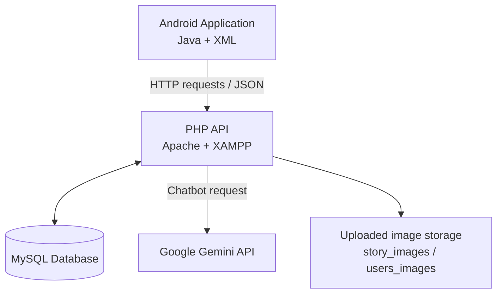
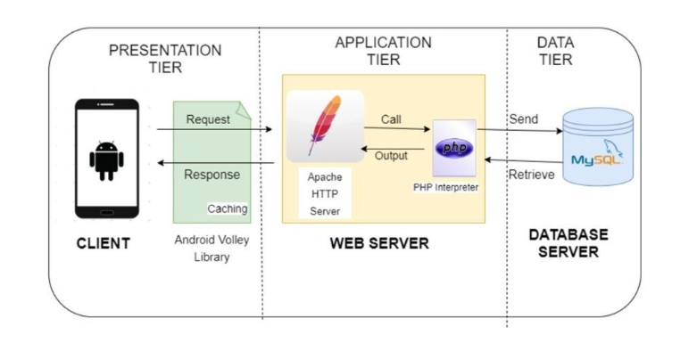
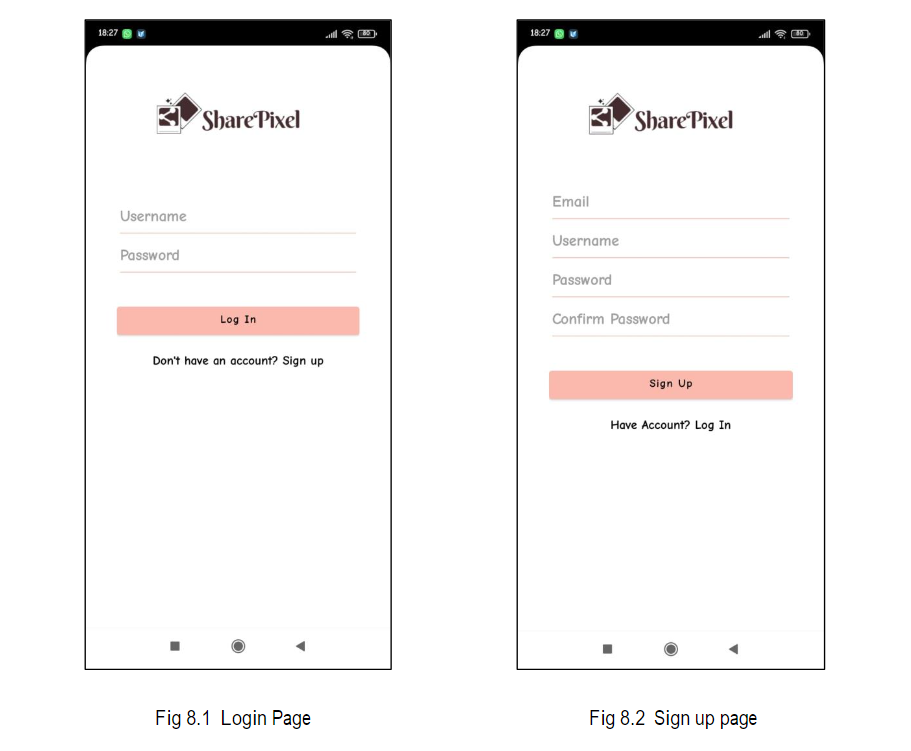
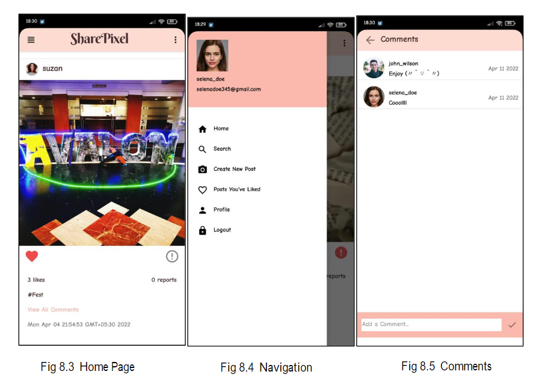
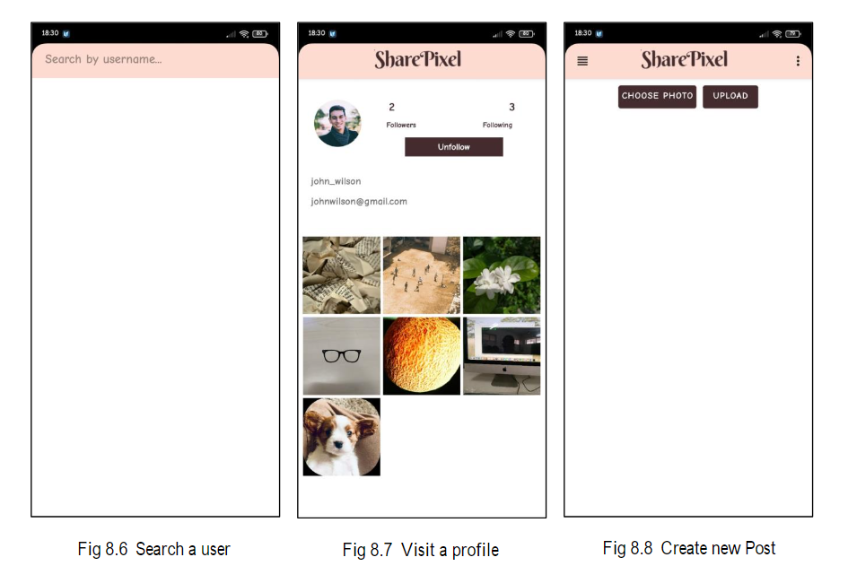
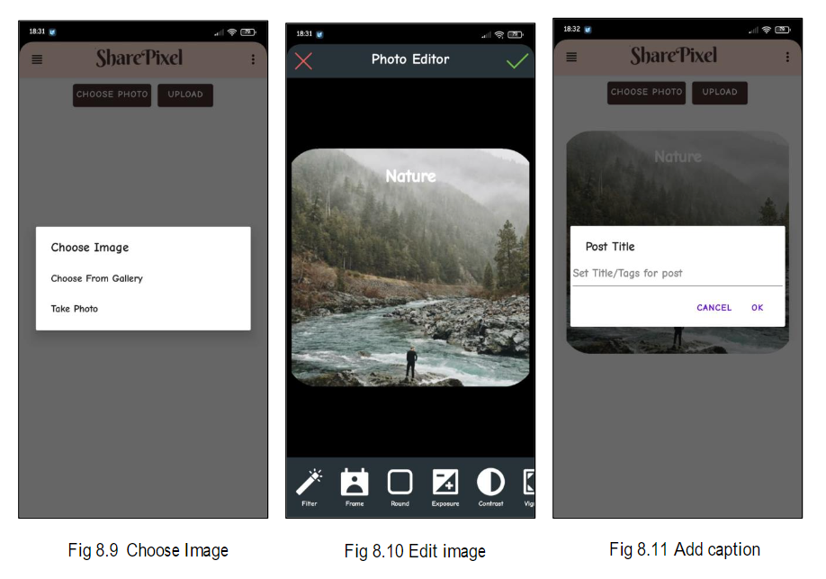
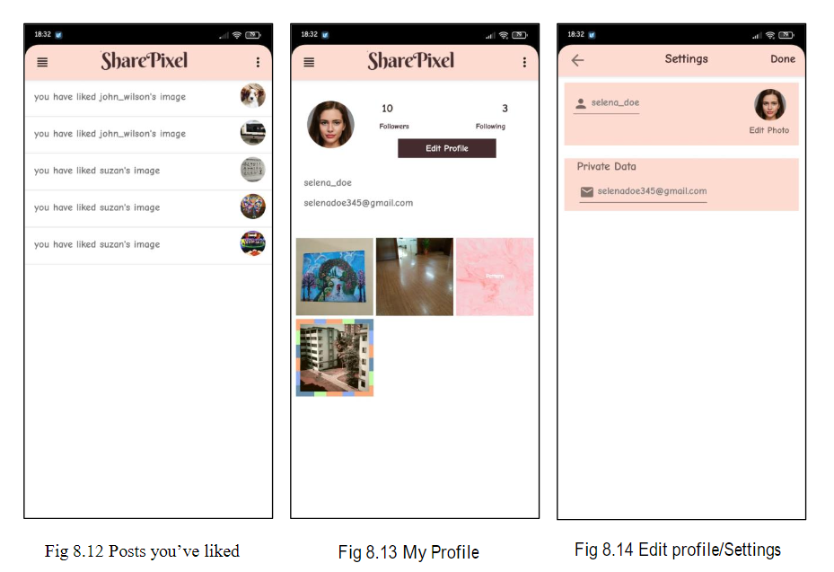
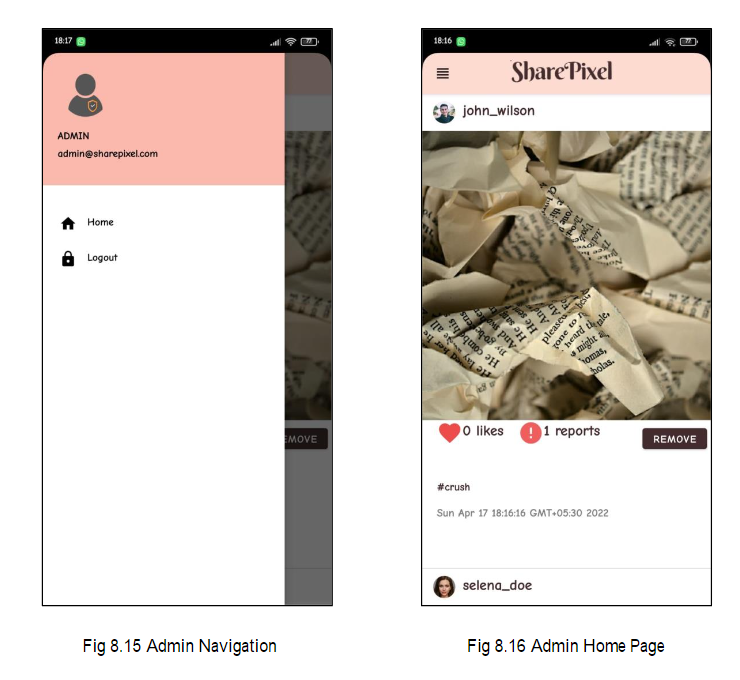

# Android Social Network AI Chatbot

An Android social networking application with an AI chatbot, image-based posts, social interactions, user profiles, administration tools, and marketplace/payment functionality.

> **Project type:** Academic group project  
> **Development period:** April 2025 – July 2025  
> **Primary application:** Android (Java and XML)  
> **Backend:** PHP API and MySQL  
> **AI integration:** Google Gemini API

## Overview

Android Social Network AI Chatbot is an academic Android application that combines core social networking features with an AI-powered chatbot. Users can create accounts, publish image-based posts, interact with other users, follow profiles, and communicate with the chatbot. The project also includes administration features for reviewing user reports and managing offensive posts.

The application was developed in Android Studio using Java and XML. The backend runs as a PHP API on Apache through XAMPP and stores application data in MySQL. The Android client communicates with the backend over HTTP during local development. Chatbot requests are sent from the PHP backend to the Gemini API; the Gemini API key is kept in the backend configuration rather than embedded in the Android application.

The project initially used Firebase during development. The current local setup described in this README uses MySQL as its database, with the database schema and seed data provided in the `Database` directory.

## Features

### User features

- Sign up and log in.
- Browse the social feed and view posts from other users.
- Create image posts with captions.
- Take a photo using the in-app camera or choose an image from the device gallery.
- Edit a selected image before publishing.
- Like posts and view like counts.
- Comment on posts and view other users' comments.
- Search for users and view their profiles and previous posts.
- Follow and unfollow other users.
- View posts liked by the current user.
- Edit profile information, including name, description, and email.
- Report posts as offensive.
- Use the AI chatbot through the Gemini API.
- Access marketplace and payment-related functionality included in the project.
- Log out.

### Image editing

The image-editing tools described in the project include:

- Brightness
- Contrast
- Warmth
- Saturation
- Vignette
- Sharpen

The original project notes also identify the following as possible additional enhancements. Treat them as planned ideas rather than completed features unless the current source code contains working implementations:

- Frames and rounded image corners
- Pixelation
- Drawing on images
- Stickers
- Text overlays

### Admin features

- Admin login.
- Review user complaints/reports.
- Block posts reported as offensive.
- Log out.

An ordinary account can be granted admin access in the local development database. See [Enable an admin account](#enable-an-admin-account).

## My contributions

The project was developed as an academic group project. My contributions, as described in my CV, include:

- Developing Android application workflows for account registration/login, posting, and social interactions.
- Integrating the Android application with the PHP API and MySQL database.
- Working on the database transition from Firebase to MySQL as the project requirements changed.
- Integrating the AI chatbot through an API, with Gemini requests handled by the PHP backend.
- Contributing to marketplace and payment-related functionality.
- Testing and refining the application in a local Windows, XAMPP, and Android Emulator environment.

> Keep this section aligned with the work you personally implemented. Be prepared to explain your own code and contributions during an interview.

## Technology stack

| Area | Technologies |
|---|---|
| Android application | Java, XML, Android Studio, Android SDK, Gradle |
| Backend API | PHP |
| Web server / local environment | Apache, XAMPP |
| Database | MySQL, phpMyAdmin |
| AI chatbot | Google Gemini API |
| Earlier development stage | Firebase |
| Local testing | Windows, Android Emulator |

## System architecture



- **Android client:** User interface and application workflows.
- **PHP API:** Handles application requests, database operations, session validation, and chatbot requests.
- **MySQL:** Stores application data.
- **Gemini API:** Generates chatbot responses. The API key is configured on the PHP backend.
- **File storage:** The PHP application uses the `story_images` and `users_images` directories for uploaded images.

## Screenshots

The repository includes screenshots under `docs/product-screenshots/`.

### System architecture



### Login and registration



### Feed, navigation, and comments



### Search, user profiles, and creating a post



### Selecting and editing an image



### Liked posts, profile, and settings



### Admin interface



## Requirements

The following setup is for local development on Windows:

- Windows 10/11.
- Android Studio.
- Eclipse Temurin JDK 17.0.15 (or a compatible JDK 17 installation supported by the project Gradle configuration).
- Android SDK Platform 30 and Android Build Tools 30.0.3, if requested by Android Studio.
- XAMPP with Apache, MySQL/MariaDB, and PHP.
- PHP cURL extension enabled for Gemini API requests.
- A Google Gemini API key from [Google AI Studio](https://aistudio.google.com/apikey).
- An Android Emulator. The default API address in this guide is configured for the Android Emulator.

The configured Gemini model is `gemini-3.5-flash-lite`. Check Google's [Gemini API model documentation](https://ai.google.dev/gemini-api/docs/models/gemini-3.5-flash-lite) if you change the model or need to confirm current API availability.

## Project structure

The repository root is the Android project root. Open the directory containing `settings.gradle` in Android Studio.

```text
Android-Social-Network-AI-Chatbot/
├── app/                         # Android application source
├── Database/
│   └── id18420043_sharepixel.sql # MySQL schema and seed data
├── SharePixel_php_files/         # PHP API source and example configuration
├── docs/
│   └── product-screenshots/      # Architecture and application screenshots
├── settings.gradle
└── README.md
```

The PHP deployment directory uses the legacy application path `SharePixel`. The database name and PHP directory name are retained for compatibility with the existing source configuration.

## Installation and setup (first run)

### 1. Clone or download the repository

Clone the repository or download it as a ZIP file. Extract it to a convenient local directory.

Open the repository root in Android Studio. It must be the directory containing `settings.gradle`, `app`, `Database`, and `SharePixel_php_files`.

### 2. Start XAMPP

1. Open **XAMPP Control Panel**.
2. Click **Start** for **Apache**.
3. Click **Start** for **MySQL**.

Keep both services running while using the application.

### 3. Create and import the MySQL database

1. Open [http://localhost/phpmyadmin](http://localhost/phpmyadmin).
2. Select **New** and create a database named `id18420043_sharepixel`.
3. Set the collation to `utf8_unicode_ci` if that option is available.
4. Select the new database and open the **Import** tab.
5. Choose the SQL file from the repository:

   `Database/id18420043_sharepixel.sql`

6. Start the import and confirm that phpMyAdmin completes it successfully.

The SQL file contains the database schema and seed data for the project. For a fresh local installation, import this file once; do not run the same full import repeatedly over a database that already contains data.

### 4. Create a dedicated MySQL account for the PHP API

Do not configure the PHP application to connect as MySQL `root`. In phpMyAdmin, select the `id18420043_sharepixel` database, open the **SQL** tab, and execute the following statements. Replace the example password with a new, strong password that you have not used elsewhere:

```sql
CREATE USER 'sharepixel_app'@'localhost'
IDENTIFIED BY 'REPLACE_WITH_A_NEW_LOCAL_PASSWORD';

GRANT SELECT, INSERT, UPDATE, DELETE
ON `id18420043_sharepixel`.*
TO 'sharepixel_app'@'localhost';

FLUSH PRIVILEGES;
```

Remember the new password. You will enter the same password in the local `db_config.php` file in the next step. Never put the real password in this README, in the repository, or in a ZIP file shared with others.

### 5. Deploy the PHP API to XAMPP

1. In Windows Explorer, create this directory if it does not already exist:

   `C:\xampp\htdocs\SharePixel`

2. Open the repository's `SharePixel_php_files` directory.
3. Copy the **contents** of `SharePixel_php_files` into `C:\xampp\htdocs\SharePixel`. Do not copy the entire Android project into `htdocs`.
4. Preserve the PHP files, `.htaccess`, `story_images`, `users_images`, and any other folders/files required by the PHP source.
5. Confirm that the example configuration is present at:

   `C:\xampp\htdocs\SharePixel\db_config.example.php`

6. Make a copy of `db_config.example.php` in the same XAMPP directory and rename the copy to `db_config.php`.

### 6. Configure the local PHP API

Open:

`C:\xampp\htdocs\SharePixel\db_config.php`

Configure it with your local MySQL credentials and your own Gemini API key. The following is a template; replace both secret placeholders with your own values:

```php
<?php
return array(
    'db_host' => 'localhost',
    'db_name' => 'id18420043_sharepixel',
    'db_user' => 'sharepixel_app',
    'db_password' => 'REPLACE_WITH_THE_NEW_LOCAL_MYSQL_PASSWORD',
    'base_url' => 'http://10.0.2.2/SharePixel',
    'gemini_api_key' => 'YOUR_GEMINI_API_KEY',
    'gemini_model' => 'gemini-3.5-flash-lite'
);
?>
```

- `db_password`: use the new password created in Step 4.
- `base_url`: `http://10.0.2.2/SharePixel` is for the Android Emulator to reach the PHP server running on the Windows host.
- `gemini_api_key`: create your own key in [Google AI Studio](https://aistudio.google.com/apikey).
- `gemini_model`: the model identifier configured for this project.

**Important security rules:**

- Keep `db_config.php` in the XAMPP deployment directory; do not copy it into the Git repository.
- Never commit or share the MySQL password or Gemini API key.
- Keep `db_config.example.php` as a placeholder-only template.
- The PHP `.htaccess` file is intended to prevent direct web access to `db_config.php`; keep it in place.
- Do not put the Gemini API key in Android Java/XML source code. The PHP backend should make the Gemini request.

### 7. Enable PHP cURL

The PHP backend uses cURL for requests to Gemini. Check that the PHP cURL extension is enabled in the XAMPP PHP configuration. If you change `php.ini`, restart Apache in XAMPP.

### 8. Check the local PHP endpoint

Open the following URL in a Windows browser:

[http://localhost/SharePixel/login.php](http://localhost/SharePixel/login.php)

The endpoint may return JSON or a message indicating that request parameters are required. It is an API endpoint, not a browser-based login page. The important checks are that Apache serves the PHP file and that PHP does not report a database/configuration error.

### 9. Configure Android Studio and Gradle

1. Open Android Studio.
2. Select **Open** and choose the repository root containing `settings.gradle`.
3. Open **File → Settings → Build, Execution, Deployment → Build Tools → Gradle**.
4. Under **Gradle JDK**, select **JAVA_HOME Eclipse Temurin 17.0.15**.
5. On the development computer used for the original setup, the JDK path was:

   `C:\Program Files\Eclipse Adoptium\jdk-17.0.15.6-hotspot`

   This is a machine-specific example. Select the actual JDK 17 installation path on your computer.
6. Select **File → Sync Project with Gradle Files**.
7. If Android Studio asks to install Android SDK Platform 30 or Android Build Tools 30.0.3, install the requested components.

### 10. Run the Android application

1. In Android Studio, open **Tools → Device Manager**.
2. Start an Android Virtual Device (Android Emulator).
3. Confirm that Apache and MySQL are still running in XAMPP.
4. Select the running emulator in Android Studio.
5. Click **Run ▶** to build and launch the application.
6. When the app opens, select **Sign Up** to create an account.
7. Sign in and test the feed, post creation, profile, interactions, and chatbot.
8. Open the navigation menu and select **Android Social Network AI Chatbot** to access the chatbot. Send a test question to verify that the PHP backend can reach Gemini.

The application uses `10.0.2.2` as the Android Emulator address for the host computer. This is why the local `base_url` is different from the browser address `http://localhost/SharePixel`.

## Running the application after the first setup

For subsequent runs, the database and local PHP configuration do not need to be recreated.

1. Open XAMPP Control Panel.
2. Start Apache and MySQL.
3. Open the repository root in Android Studio.
4. Start the Android Emulator from Device Manager if it is not already running.
5. Select the emulator and click **Run ▶**.

Keep `C:\xampp\htdocs\SharePixel\db_config.php` in place. Do not re-import the SQL file unless you intentionally want to reset/rebuild the local database.

## Enable an admin account

The recommended local workflow is to create a normal account through the app first, then grant that account admin privileges in the local database.

1. Sign up in the Android application.
2. Open phpMyAdmin and select the `id18420043_sharepixel` database.
3. Open the **SQL** tab and run the following query, replacing `YOUR_USERNAME` with the username you registered:

```sql
UPDATE users
SET is_admin = 1
WHERE username = 'YOUR_USERNAME';
```

4. Log out of the Android application.
5. Log in again so the application can load the updated account role.

Only grant admin privileges to an account you control. Do not expose an admin-enabled demo account or predictable demo credentials in a public deployment.

## Running on a physical Android device (optional)

The default `10.0.2.2` address is for an Android Emulator. To test on a physical Android phone:

1. Connect the phone and Windows computer to the same trusted Wi-Fi network.
2. On Windows, run `ipconfig` and find the computer's IPv4 address for that network (for example, `192.168.x.x`).
3. In the Android source file `app/src/main/java/com/beproject/sharepixel/URLS.java`, update the API base URL to use the Windows computer's IPv4 address and `/SharePixel/` path.
4. In `C:\xampp\htdocs\SharePixel\db_config.php`, update `base_url` to the same LAN address.
5. Add the computer's IPv4 address to the allowed domains/hosts in `app/src/main/res/xml/network_security_config.xml`, following the existing configuration format.
6. Allow Apache through Windows Firewall for the private network, if Windows prompts you.
7. Rebuild and run/install the Android application again.

This optional setup uses local HTTP traffic. Only test on a trusted private network. Do not expose the XAMPP Apache server to the public Internet, and do not use this HTTP configuration for production or sensitive data.

## Database notes and upgrades

- The fresh-install database file is `Database/id18420043_sharepixel.sql`.
- The consolidated SQL file includes the schema, seed data, and the migrations described in its comments. A fresh installation should import the full file once.
- If you are upgrading an existing database, back it up first. Do **not** import the complete fresh-install SQL file over a database containing data.
- For an existing installation, inspect the SQL file and follow the section beginning with `-- Consolidated migrations:` only when that migration path matches the version of your existing database.
- Do not run migration statements blindly against production or data you cannot restore.

## Security and privacy considerations

This repository describes a local academic/demo setup, not a production deployment.

- Use new local-only credentials. Do not reuse passwords from personal accounts or other systems.
- The password shared in the development instructions must be considered exposed and should be rotated before you publish or share the project. Do not reuse it.
- Never commit `db_config.php`, database passwords, Gemini API keys, Android signing keys, or other credentials.
- Review the complete Git history before making the repository public. Removing a secret from the latest file does not remove it from earlier commits. Rotate any credential that was committed or shared.
- The SQL dump may include demo users or sample data. Demo credentials can be predictable; change or remove them before sharing the database or using real data.
- Do not upload real users' personal information, private messages, private images, or other sensitive data.
- Do not enter sensitive personal information into the chatbot.
- The app uses local HTTP configuration for development. Production deployment would require HTTPS, secure configuration/secret storage, server hardening, access-control review, rate limiting, privacy review, and end-to-end testing.
- The backend's session and chatbot limits are implementation-specific. The current project documentation describes session tokens with a 30-day expiry and a limit of 10 chatbot messages per account per 5 minutes; verify these values against the source before relying on them.

## Troubleshooting

### Android Emulator cannot connect to the PHP API

- Confirm Apache is running in XAMPP.
- Confirm the PHP files are in `C:\xampp\htdocs\SharePixel`.
- Confirm the Android Emulator API URL uses `10.0.2.2`, not `localhost`.
- Confirm `base_url` in `db_config.php` is `http://10.0.2.2/SharePixel` for the emulator setup.
- Check Windows Firewall and Apache logs if the server cannot be reached.

### PHP reports a database connection error

- Confirm MySQL is running.
- Confirm the database name is `id18420043_sharepixel`.
- Confirm the `sharepixel_app` account exists and has access to the database.
- Confirm `db_password` in `db_config.php` matches the password assigned to `sharepixel_app`.
- Confirm `db_config.php` is in the XAMPP `SharePixel` directory and is based on the example configuration.

### Chatbot requests fail

- Confirm the computer has Internet access.
- Confirm PHP cURL is enabled and Apache has been restarted after any `php.ini` change.
- Confirm the Gemini API key is valid and configured in the XAMPP `db_config.php` file.
- Confirm the configured model identifier is available to the API key/project.
- Check the PHP/Apache error logs and API response for the underlying error. Never paste an API key into an issue, screenshot, or public log.

### Gradle sync or JDK errors

- Select a compatible JDK 17 installation under **Settings → Build Tools → Gradle → Gradle JDK**.
- Sync the project again.
- Install Android SDK Platform 30 and Build Tools 30.0.3 if the project requests them.

## Preparing the repository for publication

Before pushing the project to a public GitHub repository:

- Include the Android source code, PHP API source, SQL schema/seed file, README, and non-sensitive screenshots needed to understand the project.
- Include `db_config.example.php` only if it contains placeholders and no real secrets.
- Do not include `db_config.php`, API keys, database passwords, signing keys, local IDE files, build output, generated APK/AAB files, or real user-uploaded images.
- Review `.gitignore` and scan both the current files and Git history for secrets.
- Replace or remove personal/demo data from the SQL dump where appropriate.
- Verify that every screenshot referenced in this README exists at the stated path.
- Test the installation steps from a clean local copy before sharing the repository with a recruiter.

A useful `.gitignore` review should cover at least:

```gitignore
# Local secrets and configuration
**/db_config.php
local.properties
*.jks
*.keystore

# Android / Gradle build output
.gradle/
**/build/
*.apk
*.aab

# IDE files
.idea/
*.iml

# Local Python/OS noise, if present
.DS_Store
Thumbs.db
```

Do not add a broad ignore rule that accidentally hides source files required to build or run the application. Keep `db_config.example.php` tracked only when it contains dummy placeholders.

## Notes

- The Android application display/title used in this README is **Android Social Network AI Chatbot**.
- Legacy technical identifiers such as the PHP directory `/SharePixel`, database name `id18420043_sharepixel`, and existing Android package/source paths are retained for compatibility with the current code. Do not rename them independently without updating all corresponding Android and PHP configuration references.
- This README documents the project based on the current project notes. Confirm marketplace/payment implementation details, image-editing tools, session limits, and any other feature-specific claims against the source code before presenting them as completed functionality.

## Author

**Võ Thái Học**  
GitHub: [@VoThaiHocVN2005](https://github.com/VoThaiHocVN2005)
